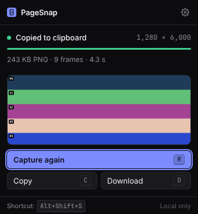
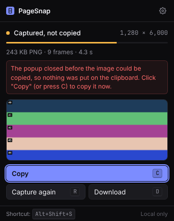
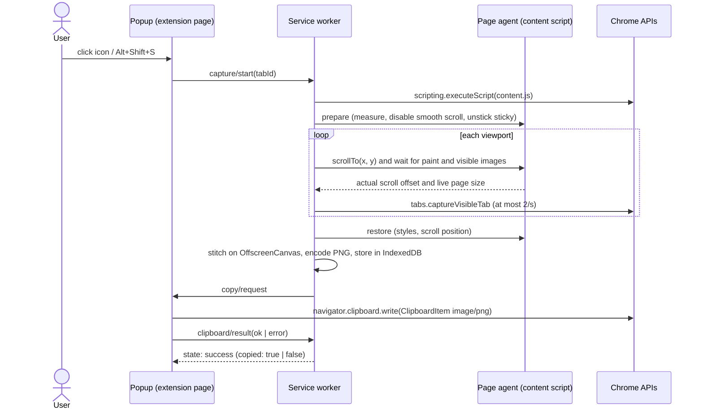

# PageSnap

**One click captures the whole webpage, not just the visible part, and copies it to your clipboard as one PNG.**

Paste it into ChatGPT, Claude, Cursor, a bug report, Slack, or Figma. No account, no upload, no API key. Everything stays on your machine.

[](https://github.com/scrigot/pagesnap/actions/workflows/ci.yml)


<p>
  
  
</p>

<sub>These are real screenshots of the extension's popup page, taken by the end-to-end test suite in Chromium (`tests/e2e/clipboard.spec.ts`).</sub>

---

## Contents

- [Why](#why)
- [Features](#features)
- [Install](#install)
- [Usage](#usage)
- [Where you can paste](#where-you-can-paste)
- [How it works](#how-it-works)
- [Privacy and permissions](#privacy-and-permissions)
- [Known limitations](#known-limitations)
- [Development](#development)
- [Testing](#testing)
- [Measured results](#measured-results)
- [Repository layout](#repository-layout)
- [Roadmap and research](#roadmap-and-research)
- [Contributing](#contributing)
- [License](#license)

## Why

AI assistants are better when they can see what you see. But Chrome's built-in screenshot tools capture only the visible viewport, and full-page capture is buried in DevTools (`Cmd/Ctrl+Shift+P` → "Capture full size screenshot"), which saves a file instead of copying it. Getting a long page into a chat takes too many steps.

PageSnap does it in one step: click the icon (or press `Alt+Shift+S`), wait a few seconds, paste.

## Features

- **Full-page capture.** Scrolls the page, captures each viewport, and stitches the frames into one image. Content below the fold is included.
- **Copied automatically.** The PNG goes onto the system clipboard as `image/png`. No download and no extra click in the normal flow.
- **Pixel-accurate.** On the test fixtures, output is pixel-identical to Chrome DevTools' own full-page screenshot ([measured](#measured-results)).
- **High-DPI and zoom aware.** Output resolution follows the real device pixel ratio and browser zoom, measured from the captured bitmaps.
- **Sticky and fixed elements handled.** Sticky headers render once, in place. Fixed headers and banners appear only in the first frame instead of repeating down the page.
- **App shells supported.** On pages where an inner panel scrolls instead of the document (chat apps, dashboards), PageSnap finds that panel and captures all of it.
- **Lazy content.** Waits for images in view to load and follows pages that grow while scrolling, up to a configurable height cap.
- **Page always restored.** Scroll position and every temporary style change are reverted, including after errors and cancellation.
- **Honest outcomes.** If the clipboard write fails, the popup says "Captured, not copied" and puts **Copy** first. Oversized pages are downscaled or cut only with a visible warning.
- **Keyboard-first popup.** `Enter`, `C`, `D`, `R`, `Esc`, and `S` cover every action.
- **Local-first.** No network requests, telemetry, or accounts, and no remote code.

## Install

PageSnap is not on the Chrome Web Store yet. Install it from source in about a minute:

```bash
git clone https://github.com/scrigot/pagesnap.git
```

```bash
cd pagesnap && npm ci && npm run build
```

1. Open `chrome://extensions`.
2. Turn on **Developer mode** (top right).
3. Click **Load unpacked** and select the `dist/` folder.
4. Optional: pin PageSnap from the puzzle-piece menu so the icon stays visible.

Requires Chrome 116 or newer, or another Chromium browser (Edge, Brave, Arc). See [docs/INSTALLATION.md](docs/INSTALLATION.md) for details and updating.

## Usage

1. Open any regular webpage.
2. Click the PageSnap icon, or press **`Alt+Shift+S`**.
3. Keep the tab in front while the progress bar runs, usually a few seconds.
4. When the popup says **Copied to clipboard**, paste anywhere with `Cmd/Ctrl+V`.

### Keyboard shortcuts

| Key           | Where              | Action                             |
| ------------- | ------------------ | ---------------------------------- |
| `Alt+Shift+S` | Anywhere in Chrome | Open PageSnap and start capturing  |
| `Enter`       | Popup              | Capture                            |
| `C`           | Popup              | Copy the last capture again        |
| `D`           | Popup              | Download the last capture as PNG   |
| `R`           | Popup              | Capture again                      |
| `Esc`         | Popup              | Cancel a running capture, or close |
| `S`           | Popup              | Open settings                      |

**Changing the global shortcut:** Chrome manages extension shortcuts itself. Open `chrome://extensions/shortcuts`, find PageSnap, click the pencil next to "Activate the extension," and press the key combination you want. The settings page has a button that opens this screen. If `Alt+Shift+S` conflicts with another extension, Chrome leaves PageSnap's shortcut unset. Set it there.

### Settings

Open them from the gear icon in the popup.

| Setting                  | Default   | What it does                                                              |
| ------------------------ | --------- | ------------------------------------------------------------------------- |
| Start on open            | On        | Clicking the icon or pressing the shortcut starts capturing right away    |
| Copy to clipboard        | On        | Copies the PNG when capture finishes                                      |
| Also download            | Off       | Saves to Downloads too (asks for the optional `downloads` permission)     |
| Close popup after copy   | Off       | Dismisses the popup after a successful copy                               |
| Delay per frame          | 0 ms      | Extra wait after each scroll, for animated pages                          |
| Maximum capture height   | 30,000 px | Stops infinite-scroll pages                                               |
| Oversized output         | Downscale | Whether to downscale or cut height when Chrome's canvas limit is exceeded |
| Show fixed elements once | On        | Hides fixed headers and banners after the first frame                     |
| Unstick sticky elements  | On        | Renders sticky elements in their natural position                         |

## Where you can paste

PageSnap puts a standard `image/png` on the system clipboard. Whether a destination accepts it depends on that destination. **None of the destinations below are exercised by this project's automated tests.** CI verifies the clipboard contents, not the paste target. The table reflects each tool's documented behavior as of November 2026.

| Destination                                                | Paste with                                      | Notes                                                                                                                                                                                                                                                                      |
| ---------------------------------------------------------- | ----------------------------------------------- | -------------------------------------------------------------------------------------------------------------------------------------------------------------------------------------------------------------------------------------------------------------------------- |
| ChatGPT (web)                                              | `Cmd/Ctrl+V` in the message box                 | Image attachments require a plan and model that accept images.                                                                                                                                                                                                             |
| Claude (claude.ai, desktop app)                            | `Cmd/Ctrl+V`                                    | Pasted images attach to the message.                                                                                                                                                                                                                                       |
| Claude Code (terminal)                                     | `Ctrl+V` on macOS/Linux, **`Alt+V` on Windows** | Claude Code reads the clipboard image itself, so the terminal's own paste (`Cmd+V`, `Ctrl+Shift+V`) usually sends text only. Some terminals intercept the binding. See the [keyboard shortcuts docs](https://code.claude.com/docs/en/interactive-mode#keyboard-shortcuts). |
| Cursor (chat / agent)                                      | `Cmd/Ctrl+V` in the chat input                  | There are open reports of image paste failing on Windows. Fall back to **Download** and drag the file in.                                                                                                                                                                  |
| VS Code + Copilot Chat                                     | Not verified                                    | Use **Download**, then attach the file.                                                                                                                                                                                                                                    |
| Slack, Notion, Linear, GitHub comments, Figma, Google Docs | `Cmd/Ctrl+V`                                    | Standard rich-paste targets.                                                                                                                                                                                                                                               |
| Plain text fields, terminals without image support         | Not supported                                   | They can only receive text.                                                                                                                                                                                                                                                |

Very tall images may be downscaled by the destination before a model sees them. For long pages, a narrower browser window keeps text more legible after downscaling. This is a hypothesis we plan to measure (see [research](research/README.md)).

## How it works



**Why the clipboard write happens in the popup.** Manifest V3 service workers have no `navigator.clipboard`. Offscreen documents are never focused, so the async Clipboard API rejects there, and the documented offscreen workaround (`document.execCommand('copy')`) only handles text. The popup is a focused extension page with the `clipboardWrite` permission, which is the supported place to write an image. If the popup closes before the copy, PageSnap keeps the PNG and reports "Captured, not copied" instead of claiming success.

**Stitching.** Frames are placed at the page's _actual_ scroll offsets, not the requested ones. Image scale is measured from each captured bitmap, which accounts for DPR and zoom. Consecutive frames overlap by 1 CSS px, which absorbs Chrome's device-pixel scroll snapping. Without the overlap, a 1 px seam appeared at 150% zoom, and the E2E suite caught it.

Full design, state machine, and trade-offs: **[docs/ARCHITECTURE.md](docs/ARCHITECTURE.md)**.

## Privacy and permissions

| Permission             | Why                                                                                                                               |
| ---------------------- | --------------------------------------------------------------------------------------------------------------------------------- |
| `activeTab`            | Access to the current tab only after you click PageSnap or press its shortcut. No access to other tabs, and no background access. |
| `scripting`            | Inject the measuring and scrolling helper into that tab.                                                                          |
| `clipboardWrite`       | Put the PNG on the clipboard.                                                                                                     |
| `storage`              | Save your settings.                                                                                                               |
| `downloads` (optional) | Requested only when you turn on "Also download."                                                                                  |

PageSnap has no host permissions, makes no network requests, and contains no analytics or remote code. The page helper reads geometry (sizes, scroll offsets, computed `position`). It never reads text, form values, or cookies. The most recent capture is kept in the extension's local IndexedDB so you can copy it again, and it is replaced by the next capture. Details: [docs/PRIVACY.md](docs/PRIVACY.md) and [SECURITY.md](SECURITY.md).

## Known limitations

- **Restricted pages.** Chrome does not let extensions capture `chrome://` pages, the Chrome Web Store, other extensions' pages, or `file://` URLs unless you enable "Allow access to file URLs." PageSnap says so and does not try to bypass it.
- **PDF viewer and other unscriptable pages.** Only the visible area is captured, with a warning.
- **Speed.** Chrome limits `captureVisibleTab` to 2 calls per second, so a page 10 screens tall takes about 5 seconds. This is a platform limit.
- **Keep the tab in front.** Switching tabs mid-capture stops the capture with a clear error rather than capturing the wrong tab.
- **Popup must stay open for auto-copy.** If you click away, the capture still finishes. Reopen PageSnap and press `C`.
- **Fixed bottom bars.** A fixed footer or cookie banner appears once, at the bottom of the first screen, and covers whatever is beneath it there.
- **Iframes and nested scrollers.** Cross-origin iframes are captured as they render in each viewport. Their own scrollable content is not expanded. Only the single largest inner scroller is expanded on app-shell pages.
- **Canvas limits.** Chrome canvases max out around 32,767 px per side. Taller output is downscaled (or cut, if you choose) with a warning. The default cap is 30,000 CSS px.
- **Scroll-driven effects.** Parallax, scroll-triggered animations, and pages that hijack scrolling may stitch imperfectly. Try **Delay per frame**.
- **Hover states.** If your pointer rests over the page, hover styles can appear in one frame.

More fixes: [docs/TROUBLESHOOTING.md](docs/TROUBLESHOOTING.md).

## Development

```bash
npm ci
```

```bash
npm run build        # production build -> dist/
```

```bash
npm run check        # typecheck + lint + format check + unit tests + build
```

```bash
npm run test:e2e     # real-Chromium tests (builds dist-e2e first)
```

Stack: TypeScript (strict), Manifest V3, Vite (two passes: pages and module service worker, then the content script as an IIFE), Vitest, Playwright, ESLint, and Prettier. The only runtime code is what ships in `dist/`. There are no production dependencies.

The UI is plain TypeScript and CSS. React wasn't justified for one popup and one settings page.

See [docs/DEVELOPMENT.md](docs/DEVELOPMENT.md) for the workflow, debugging, and release packaging.

## Testing

| Layer                         | What                                                                                                                                                                                                                                                                 | Real browser?                                                                       |
| ----------------------------- | -------------------------------------------------------------------------------------------------------------------------------------------------------------------------------------------------------------------------------------------------------------------- | ----------------------------------------------------------------------------------- |
| Unit (`tests/unit`, 54 tests) | Scroll position generation, overlap, stitch coordinates, DPR and zoom scale, output size limits, state machine transitions, coordinator loop (cancel, errors, growth, stuck pages), settings, error mapping                                                          | No. Clipboard tests here use a **mocked** Clipboard API and are labeled as such.    |
| E2E (`tests/e2e`, 21 tests)   | Short, long, sticky, fixed, dynamic, app-shell, wide, narrow, 150% zoom, DPR 2, lazy images, height cap, 40,000 px downscale, `chrome://`, cancel and recovery, duplicate start, popup auto-copy, popup-closed recovery, settings persistence, production build load | **Yes.** Real Chromium with the real extension, asserting on decoded output pixels. |

What E2E does **not** prove: headless Chromium has its own clipboard, so the tests verify that PageSnap's write succeeds and that the clipboard holds a decodable `image/png` of the right size, but not the OS clipboard or pasting into another app. The E2E build differs from production in three declared ways: an `<all_urls>` host permission (Playwright cannot click the toolbar to grant `activeTab`), `clipboardRead` (to read results back), and a service-worker test hook. A separate test loads the **production** build and checks that it has none of these. The manual release checklist is in [docs/TESTING.md](docs/TESTING.md).

## Measured results

From `npm run bench` (3 runs per fixture, headless Chromium 153 in a 4-vCPU Linux container, 1280×800 window). These are real numbers. See [docs/BENCHMARKS.md](docs/BENCHMARKS.md) for both device scales and method.

| Fixture         | Output    | Frames | Capture time (median) | Alignment error | Matches DevTools full-page screenshot |
| --------------- | --------- | ------ | --------------------- | --------------- | ------------------------------------- |
| long (60 bands) | 1280×6000 | 9      | 4.9 s                 | 0 px            | 100.0% of pixels                      |
| sticky header   | 1280×5060 | 8      | 5.0 s                 | 0 px            | n/a (by design)                       |
| fixed header    | 1280×5050 | 8      | 4.9 s                 | 0 px            | n/a (by design)                       |
| infinite scroll | 1280×6000 | 9–11   | 6.1 s                 | 0 px            | n/a                                   |
| app shell       | 1080×4000 | 7      | 3.7 s                 | 0 px            | n/a                                   |
| wide (2-D grid) | 2400×3000 | 10     | 5.6 s                 | n/a             | 100.0% of pixels                      |

Synthetic fixtures are not real websites. They establish geometric correctness, not real-world reliability. Measuring completion rate across real sites is on the [roadmap](ROADMAP.md).

## Repository layout

```
src/
  background/   service worker: session, state, badge, driver (Chrome APIs), downloads
  capture/      pure geometry, state machine, rate limiter, coordinator loop, stitcher
  content/      page agent: measure, scroll, unstick/hide, restore
  clipboard/    image clipboard write (runs in the popup)
  popup/        toolbar UI
  options/      settings page
  shared/       typed messages, settings, errors, logger, result store, formatting
  styles/       design tokens
  assets/icons/ generated by scripts/make-icons.py
tests/
  unit/         Vitest
  e2e/          Playwright: harness, capture, clipboard, production build
  fixtures/     deterministic HTML pages (color bands with known geometry)
scripts/        build, benchmark, icon generation
research/       evaluation code, context-bundle schema, experiment plans
docs/           architecture, install, development, privacy, testing, troubleshooting, benchmarks
```

## Roadmap and research

The goal for PageSnap is to grow from a screenshot tool into an open-source **visual context engine**: the most reliable way to hand a webpage to an AI model. The plan is tracked in **[ROADMAP.md](ROADMAP.md)**:

1. **Screenshot engine.** Done: this release.
2. **Intelligent capture.** Deduplicate fixed elements with perceptual hashing, content-aware seams, better infinite scroll.
3. **AI-ready context bundles.** Screenshot plus title, URL, dimensions, and optional extracted text and accessibility tree, with local redaction. A draft schema is in [`research/schemas`](research/schemas/context-bundle.schema.json).
4. **Evaluation.** Reproducible benchmarks for stitch fidelity, compression vs. OCR legibility, and screenshot vs. DOM-text vs. hybrid input for multimodal comprehension.
5. **Integrations.** Only where APIs are verified (MCP, Claude Code, editors).

Research questions, metrics, and data rules are in [research/README.md](research/README.md). Hypotheses are kept separate from observations, and no results are reported that have not been measured.

## Contributing

Issues and PRs are welcome. Read [CONTRIBUTING.md](CONTRIBUTING.md) first. In short: `npm run check` must pass, behavior changes need tests, and capture changes should come with an E2E fixture. Please follow the [Code of Conduct](CODE_OF_CONDUCT.md). Report security issues privately per [SECURITY.md](SECURITY.md).

## License

[MIT](LICENSE)
