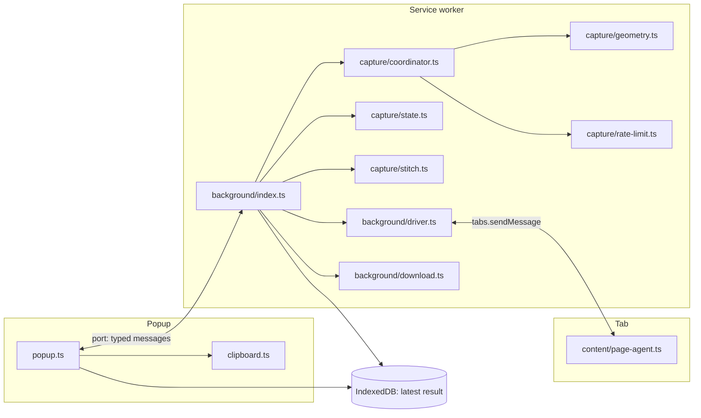
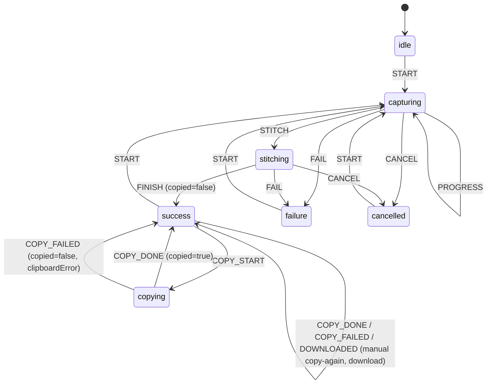

# Architecture

PageSnap is a Manifest V3 extension with four execution contexts. Each one does only what that context is allowed and suited to do.

| Context                                             | File(s)                                     | Responsibility                                                                                            |
| --------------------------------------------------- | ------------------------------------------- | --------------------------------------------------------------------------------------------------------- |
| **Popup** (extension page)                          | `src/popup/*`, `src/clipboard/clipboard.ts` | UI, keyboard handling, **clipboard write**, manual download                                               |
| **Service worker**                                  | `src/background/*`                          | Owns the single capture session and state machine. Talks to Chrome APIs, stitches, and stores the result. |
| **Page agent** (content script, injected on demand) | `src/content/page-agent.ts`                 | Measures geometry, scrolls, temporarily adjusts styles, and restores the page                             |
| **Options page**                                    | `src/options/*`                             | Settings, shortcut info, permissions, diagnostics                                                         |

Pure logic with no Chrome APIs lives in `src/capture/` (`geometry.ts`, `state.ts`, `rate-limit.ts`, `coordinator.ts`) and `src/shared/`. That is what the unit tests cover.

## Module map



All messages are typed in `src/shared/messages.ts`:

- `PopupToBackground` / `BackgroundToPopup`: a long-lived `runtime.Port` named `pagesnap-popup`. The port also serves as the popup-presence signal.
- `AgentRequest` / `AgentResponse`: one-shot `tabs.sendMessage` to frame 0 of the target tab.

The service worker and popup exchange no image bytes over messaging. The PNG `Blob` is written to IndexedDB (`src/shared/result-store.ts`), and the popup reads it from the same extension origin.

## Capture sequence

```mermaid
sequenceDiagram
  participant P as Popup
  participant SW as Service worker
  participant A as Page agent
  participant T as chrome.tabs

  P->>SW: capture/start(tabId)
  SW->>SW: START (idle→capturing); listen for tab removed/navigated
  SW->>A: executeScript(content.js) [idempotent]
  alt injection fails (PDF viewer, etc.)
    SW->>T: captureVisibleTab → visible-only result + warning
  end
  SW->>A: agent/prepare {flattenSticky}
  A-->>SW: PageMetrics (target, client rect, content size, scroll, DPR)
  loop rows (y), then columns (x)
    SW->>A: agent/scrollTo {x, y, hideFixed: frame>0, delayMs}
    Note over A: scrollTo(behavior: instant) → rAF → await visible images (≤1.5 s)<br/>→ optional delay → 2× rAF
    A-->>SW: PageMetrics (actual scroll, current content size)
    SW->>SW: rate limiter (≥510 ms since last capture)
    SW->>T: tabs.get(tabId).active? then captureVisibleTab(png)
    SW->>P: state PROGRESS
  end
  SW->>A: agent/restore (always, in finally)
  SW->>SW: STITCH → OffscreenCanvas → PNG Blob → IndexedDB → FINISH
  alt autoCopy and popup connected
    SW->>P: COPY_START, copy/request
    P->>P: navigator.clipboard.write([ClipboardItem image/png])
    P->>SW: clipboard/result
    SW->>SW: COPY_DONE or COPY_FAILED
  else no popup
    SW->>SW: COPY_FAILED (CLIPBOARD_NO_POPUP); badge shows "1"
  end
```

## State machine

`src/capture/state.ts` is a pure reducer. Every transition goes through it, and illegal events throw `InvalidTransitionError`, so bugs surface as errors instead of impossible UI states.



Properties:

- **No simultaneous sessions.** `START` is illegal while `capturing`, `stitching`, or `copying`. The service worker checks `isBusy` and replies with the current state, so a second click or a shortcut press while the popup is open attaches to the running session instead of starting another.
- **Clipboard failure never becomes success.** A failed copy is `success` with `copied: false` and a `clipboardError`. The capture worked and the copy did not, and the UI shows both facts.
- **Cancellation** is cooperative: `AbortController` is checked between frames, and the page is restored in `finally`.

## Clipboard: why the popup writes it

| Option                                   | Image to clipboard? | Why / why not                                                                                                                                                    |
| ---------------------------------------- | ------------------- | ---------------------------------------------------------------------------------------------------------------------------------------------------------------- |
| Service worker                           | No                  | Workers have no `navigator.clipboard`.                                                                                                                           |
| Offscreen document (`reason: CLIPBOARD`) | No                  | It is never focused, so `navigator.clipboard.write` rejects. Chrome's documented offscreen pattern uses `document.execCommand('copy')`, which handles text only. |
| Content script in the page               | Unreliable          | It depends on page focus, the site's Permissions Policy, and user activation, and it would run PageSnap code in the page's clipboard context.                    |
| **Popup (extension page)**               | **Yes**             | Focused, extension origin. `clipboardWrite` permits `navigator.clipboard.write` without a fresh gesture.                                                         |

Toolbar click and the `_execute_action` shortcut both open the popup, which starts capture immediately (setting: _Start on open_). The popup is therefore present for the copy in the normal flow. If it closes first, the result stays in IndexedDB. The badge shows `1`, and reopening the popup offers **Copy** (`C`) instead of recapturing. The window for this is 2 minutes, after which opening the popup starts a new capture.

`writeImageToClipboard` takes an injectable `ClipboardEnv`, so error mapping (`NotAllowedError` → `CLIPBOARD_DENIED`, missing API → `CLIPBOARD_UNSUPPORTED`) is unit-tested with mocks. The real write is covered by E2E in Chromium.

## Scroll management (page agent)

`prepare`:

1. **Pick the target.** If the document scrolls, use it. Otherwise pick the largest visible element with `overflow-y: auto|scroll|overlay` whose content overflows and that is at least 30% of the viewport tall. This covers app shells such as chat UIs and dashboards.
2. **Disable smooth scrolling** (`scroll-behavior: auto !important` on `html`, `body`, and the target). Smooth scrolling would make `scrollTo` asynchronous and misalign frames.
3. **Unstick sticky elements** (`position: static !important`). A sticky box occupies the same layout slot as a static one, so it renders once, in place, without reflow.

`scrollTo` (per frame):

1. For frames after the first, **hide `position: fixed` elements** (`visibility: hidden !important`, which causes no reflow). The scan runs every frame because many sites switch headers to `fixed` on scroll. Ancestors of the scroll target are never hidden.
2. `scrollTo({behavior: 'instant'})`, then one `requestAnimationFrame`.
3. **Wait for incomplete images intersecting the viewport** (`load`/`error`, capped at 1.5 s). This is event-driven rather than a fixed delay.
4. Optional user delay, then two more animation frames so layout is committed and painted before capture. `rAF` has a 250 ms timeout fallback because it doesn't fire in hidden tabs.
5. Return fresh metrics: the actual scroll offset and current content size.

`restore` replays every recorded inline-style change in reverse, restoring the previous value and priority, then scrolls back to the original offset. It runs in the coordinator's `finally` and also on `pagehide`.

The agent never reads text, attributes, or form values, never dispatches events, and does not persist anything in the page.

## Capture coordination

`runCapture` (`src/capture/coordinator.ts`) depends on a `CaptureDriver` interface (prepare, scrollTo, restore, captureVisible) and a `Stitcher`. Production uses `createChromeDriver` and `stitchFrames`. Unit tests use fakes that simulate growing pages, stuck pages, failures, and DPR.

The loop advances by **rows then columns**, recomputing the next offset from **live metrics** after each frame:

- `nextAxisPosition(prev, content, view, overlap)` steps by `view - 1` CSS px and clamps the last frame to `content - view`. The 1 px overlap absorbs device-pixel scroll snapping (a seam appeared at 150% zoom without it). The clamped final frame overlaps the previous one, and overlaps are overwritten with identical pixels.
- **Growing pages** (infinite scroll, lazy sections) are followed because the content height is re-read each frame, bounded by `captureHeightLimit` (the user cap, plus the canvas limit under the _truncate_ strategy).
- **Stuck pages** (scroll stops before the reported end) are detected when a row's actual `scrollY` does not advance. Capture stops with a warning instead of looping.
- **Tab switches** are detected before each capture (`tabs.get(id).active`) because `captureVisibleTab` captures whatever tab is active in the window. Navigations and closes abort through `tabs.onUpdated` and `tabs.onRemoved`.

### Rate limit

Chrome enforces `MAX_CAPTURE_VISIBLE_TAB_CALLS_PER_SECOND = 2`. The limiter spaces captures ≥510 ms apart, counting the time already spent scrolling and settling, so it waits only for the remainder. Quota errors that still occur (for example, captures in quick succession across sessions) are retried up to 3 times after 600 ms. This limit is why a capture takes about 0.5 s per screen.

## Stitching

`stitchFrames` runs in the service worker using `OffscreenCanvas` and `createImageBitmap`.

- **Image scale is measured, not assumed:** `bitmap.width / viewport.width`. This captures DPR and browser zoom together. At 150% zoom on a 1× display, the scale is 1.5.
- Source rect = the target's client rect in the screenshot. This excludes scrollbars and, for inner scrollers, the surrounding app chrome. For the document, the client size comes from `visualViewport` because `clientWidth`/`clientHeight` are integer-rounded and the real viewport at 150% zoom is 533.33 px.
- Destination edges are **rounded independently** (`round(y*s)` and `round((y+h)*s)`), so adjacent frames share edges exactly and fractional offsets cannot produce seams or gaps.
- **Memory:** frames are held as compressed PNG data URLs and decoded one at a time. Each bitmap is `close()`d and its data URL released after drawing, so peak memory is about one output canvas plus one decoded frame.

### Size limits

`planOutput` (pure, in `geometry.ts`) enforces conservative Chromium canvas limits, 32,767 px per side and 16,384² px area:

| Situation                                                    | Behavior                                                                      | User sees                                                           |
| ------------------------------------------------------------ | ----------------------------------------------------------------------------- | ------------------------------------------------------------------- |
| Page taller than _Maximum capture height_                    | Capture stops at the cap                                                      | "Captured the first N of M px (Settings > Maximum capture height)." |
| Output exceeds canvas limits, strategy _downscale_ (default) | Uniform downscale to fit                                                      | "downscaled to N% of device resolution"                             |
| Output exceeds canvas limits, strategy _truncate_            | Full resolution, height cut at the canvas limit, decided **before** scrolling | "captured the first N px at full resolution"                        |
| Allocation or encoding fails anyway                          | `STITCH_FAILED`                                                               | Hint to lower the max height                                        |

Nothing is ever downscaled or truncated silently.

## Errors

`src/shared/errors.ts` defines stable `ErrorCode`s. Each has a user-facing hint that says what to do next: `RESTRICTED_PAGE`, `INJECTION_FAILED`, `CAPTURE_FAILED`, `TAB_CHANGED`, `STITCH_FAILED`, `CLIPBOARD_DENIED`, `CLIPBOARD_UNSUPPORTED`, `CLIPBOARD_NO_POPUP`, `NO_ACTIVE_TAB`, `NO_RESULT`, `BUSY`, and `UNKNOWN`. Restricted URLs are rejected up front (`isRestrictedUrl`). If injection fails on an otherwise capturable page, PageSnap falls back to a visible-area capture and labels it.

## Logging and diagnostics

`src/shared/log.ts` is an in-memory ring buffer (300 entries) that also writes to the service worker console. Entries record phases, timings, dimensions, and the page **origin** only. Full URLs, titles, and page content are never logged. Settings → Diagnostics shows the buffer plus the current state, and **Copy log** puts it on the clipboard for bug reports.

## Build

`scripts/build.mjs` runs Vite twice:

1. `popup/index.html`, `options/index.html`, and `background.js`, output as an ES module service worker with shared chunks.
2. `content.js` as a single **IIFE**, because content scripts injected with `executeScript({files})` cannot use `import`.

It then writes `manifest.json` with the version from `package.json`. `--e2e` writes `dist-e2e/` and sets `__E2E__ = true`, which adds the SW test hook, `<all_urls>`, and `clipboardRead`. Production builds compile the hook out, and `tests/e2e/production-build.spec.ts` asserts that.

## Design decisions

| Decision                                   | Alternative                                                               | Why                                                                                                                                                                                                                                        |
| ------------------------------------------ | ------------------------------------------------------------------------- | ------------------------------------------------------------------------------------------------------------------------------------------------------------------------------------------------------------------------------------------ |
| Scroll-and-stitch with `captureVisibleTab` | `chrome.debugger` + CDP `Page.captureScreenshot({captureBeyondViewport})` | CDP is a single call and faster, but it needs the `debugger` permission, which shows a scary install warning and a "PageSnap started debugging this browser" infobar on every capture. It is a candidate for an opt-in mode (see ROADMAP). |
| Popup-driven flow (`default_popup`)        | `action.onClicked` with no popup                                          | Without a focused extension page there is nowhere to write an image to the clipboard reliably.                                                                                                                                             |
| Unstick sticky → `static`                  | Detect "stuck" state per frame                                            | `static` reproduces the un-stuck layout exactly, with no heuristics.                                                                                                                                                                       |
| Hide fixed after frame 1                   | Crop fixed regions                                                        | Hiding uses `visibility` (no reflow) and keeps one copy where the user saw it.                                                                                                                                                             |
| Plain TS UI                                | React                                                                     | Two small pages. React would add bundle weight and no capability.                                                                                                                                                                          |
| IndexedDB result store                     | `storage.session`                                                         | `storage.session` is capped at 10 MB, and PNGs can be larger. IndexedDB stores `Blob`s natively and survives SW suspension.                                                                                                                |
